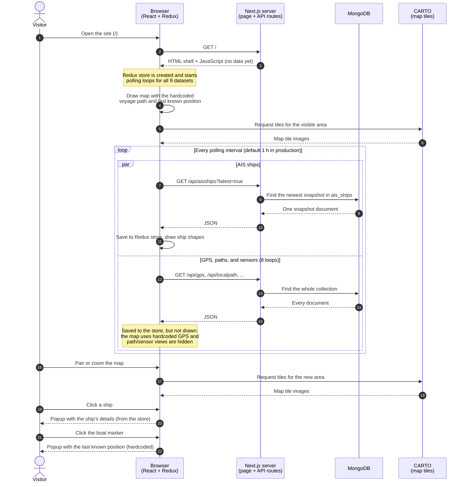

<!-- markdownlint-disable MD013 -->

# CF1: View the voyage on the map

A visitor opens the site, looks around the map, and clicks on a ship and on the boat. See "Core functionality" in [`ARCHITECTURE.md`](../ARCHITECTURE.md).

## Takeaways

- **The server sends no data with the page.** Everything arrives afterwards, through polling loops in the browser.
- **Every loop starts at once and runs on the same timer,** including the 8 whose data the map doesn't draw today. Most loops fetch the **entire collection** every time. Only AIS asks for the latest snapshot.
- **Panning, zooming, and clicking never reach our backend.** Tiles come from CARTO, and popups use data already in the browser.
- **The boat's position and path are hardcoded** since the voyage ended. While the voyage was live, they came from the GPS loop.
