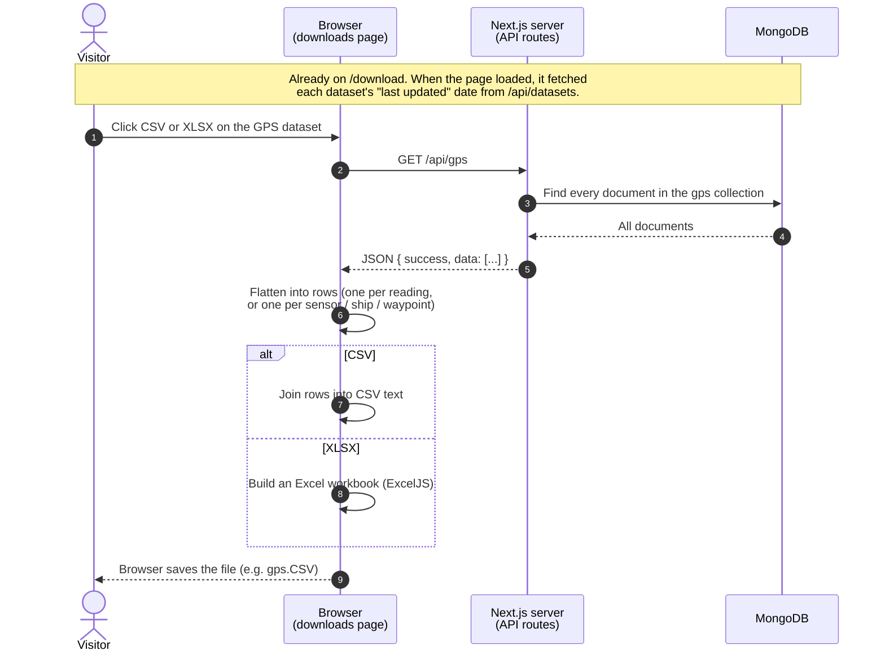

<!-- markdownlint-disable MD013 -->

# CF2: Download a dataset

A visitor already on the downloads page clicks a tabular format (CSV or XLSX) for one dataset. GPS is used as the example; every dataset follows the same path with its own endpoint. See "Core functionality" in [`ARCHITECTURE.md`](../ARCHITECTURE.md).

## Takeaways

- **One click, one request, the whole collection.** There's no filtering by date range or voyage, and no paging. The file contains everything ever stored for that dataset.
- **The file is built in the browser, not on the server.** The API only returns JSON. JSON downloads skip the flattening step and save that JSON as-is.
- **Not shown:** the background polling loops from CF1 keep running on this page too, because the Redux store is shared across the whole site.
