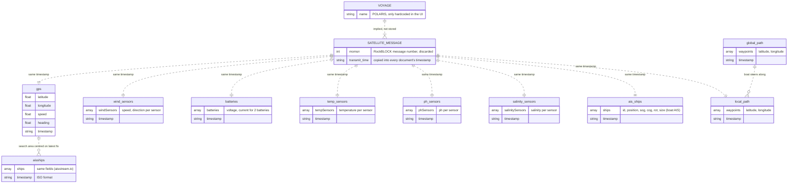

<!-- markdownlint-disable MD013 -->

# Data ER diagram

How the data the website uses relates to each other. Entities are the actual MongoDB collection names, plus two concepts that are **implied but never stored** (`VOYAGE`, `SATELLITE_MESSAGE`).

Every relationship is drawn dotted because **none of them are stored or enforced**. Readings from one satellite message are linked only by sharing the same `timestamp` string, and nothing records which voyage or boat a reading belongs to.

## Reading the diagram

- **`SATELLITE_MESSAGE` → 8 collections:** the boat sends one message per hour. The remote server splits it into exactly one document in each of eight collections.
- **`gps` → `aisships`:** the aisstream worker centres its 60 km × 60 km search area on the boat's latest GPS fix, so each AIS snapshot depends on GPS without referencing it.
- **`global_path` → `local_path`:** the global path is the full planned route, and the local path is the boat's short-term route along it. Nothing on the boat-to-website path writes `global_path` today (see "Known data issues" in `ARCHITECTURE.md`).
- **`ais_ships` vs `aisships`:** two separate collections for the same kind of data, from two different sources. The website reads only `ais_ships`.
- **Not shown:** `iridium_response`. The remote server defines it, but nothing writes to it.

## How to read it

**Line ends (crow's foot).** The symbol next to an entity says how many of _that_ entity relate to one of the entity at the other end.

| Mermaid       | Meaning      |
| ------------- | ------------ |
| `\|\|`        | exactly one  |
| `\|o` / `o\|` | zero or one  |
| `\|{` / `}\|` | one or more  |
| `o{` / `}o`   | zero or more |

For example, `VOYAGE ||..|{ SATELLITE_MESSAGE` means each message belongs to exactly one voyage, and a voyage has one or more messages.

**Lines.** Dotted means implicit: the link isn't stored or enforced. (In standard ER notation, dotted means a non-identifying relationship. This diagram uses it differently.)

**Boxes.** Each box shows what one document in that collection typically looks like. MongoDB doesn't enforce it. An `array` attribute is a list embedded in each document. In SQL it would be a separate child table.
