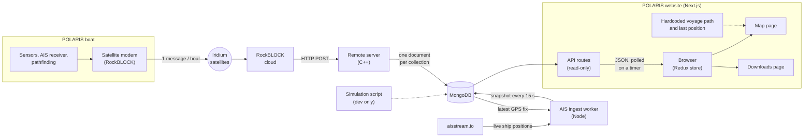

<!-- markdownlint-disable MD013 -->

# Data flow

Where the website's data comes from and how it reaches a visitor. Solid arrows are the production path; dotted arrows are dev-only or static data.

## Reading the diagram

- **Boat path (top):** the boat batches one reading of every sensor into a satellite message, sent once per hour. The remote server decodes it and writes one document to each collection.
- **AIS path (middle):** the worker streams nearby ships from aisstream.io and writes a snapshot every 15 seconds. It reads the boat's latest GPS fix back from MongoDB to decide which area to watch.
- **Website (right):** the browser polls the API on a timer. The API reads MongoDB and returns JSON, which goes into the Redux store and from there to the map and downloads pages.
- **Hardcoded data:** since the voyage ended, the map draws its path and position from a hardcoded file instead of the GPS data.
